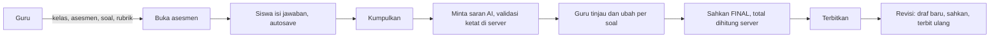
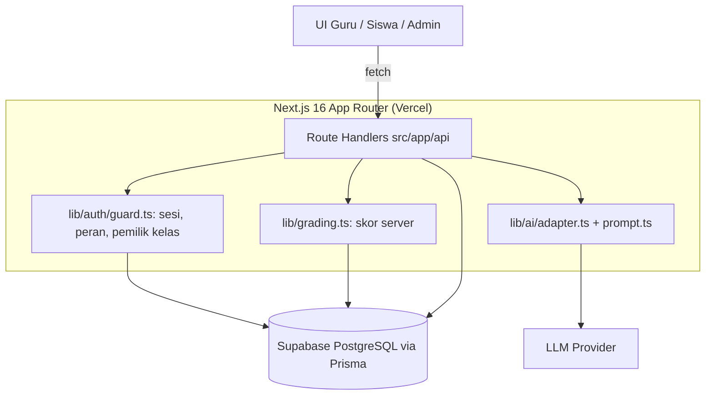

<div align="center">


# ESAINA

**AI menyiapkan draf skor + alasan + kutipan + feedback — guru memutuskan, siswa melihat hasil yang sudah diterbitkan.**

[](https://esaina.web.id)
[](https://github.com/kopsudomar/esaina/actions/workflows/ci.yml)
[](https://nextjs.org)
[](https://www.typescriptlang.org)
[](https://tailwindcss.com)
[](https://www.prisma.io)
[](LICENSE)

</div>

ESAINA (*Explainable Essay Assessment*) adalah platform penilaian esai yang menempatkan AI sebagai **pemberi saran** dan guru sebagai **pemutus**. Setiap saran membawa skor per kriteria rubrik, alasan, kutipan persis dari jawaban siswa, dan umpan balik — divalidasi ketat di server, lalu dapat dipakai, diubah, atau diabaikan guru. Siswa hanya melihat hasil yang sudah disahkan dan diterbitkan. Dibuat untuk hackathon **INCEPTION 2026** oleh tim **Kopsudomar**, dengan alur penilaian berjalan ujung-ke-ujung dan ter-deploy.

**Daftar isi:** [Sorotan](#sorotan) · [Demo](#demo) · [Masalah & Solusi](#masalah--solusi) · [Fitur Utama](#fitur-utama) · [Cara Kerja AI & Validasi](#cara-kerja-ai--validasi) · [Arsitektur](#arsitektur) · [Keamanan & Invarian Produk](#keamanan--invarian-produk) · [Alur Demo 3 Menit](#alur-demo-3-menit) · [Menjalankan Lokal](#menjalankan-lokal) · [Deployment](#deployment) · [Struktur Data](#struktur-data) · [Pengujian & CI](#pengujian--ci) · [Keterbatasan & Roadmap](#keterbatasan--roadmap) · [Tim](#tim) · [AI Use and Third-Party Declaration](#ai-use-and-third-party-declaration) · [Lisensi](#lisensi)

## Sorotan

- **Saran AI yang bisa diperiksa.** Satu saran per pasangan soal × kriteria, lengkap dengan alasan, kutipan persis, dan umpan balik — bukan satu angka tanpa dasar.
- **Guru tetap pemegang keputusan.** `AIResult` terpisah dari `GradeRevision`; AI tidak bisa mengisi, menimpa, mengesahkan, atau menerbitkan nilai.
- **Validasi keluaran ketat.** Skema, kelengkapan soal/kriteria, ID asing, rentang skor rubrik, dan keaslian kutipan diperiksa server; retry maksimal 1x, jalur manual selalu tersedia.
- **Kebenaran data penilaian.** Total skor dihitung server dari nilai guru, nilai kosong ≠ nol, dan nilai Final hanya berubah lewat revisi → sahkan → terbit ulang.
- **Aman dan teruji.** Otorisasi server pada setiap route, payload siswa memakai allowlist, jawaban diperlakukan sebagai data, `anonCode` dikirim ke LLM; Vitest + CI/CD, live di Vercel + Supabase.

## Demo

| Item | Tautan |
|---|---|
| **Live Demo** | https://esaina.web.id |
| Repositori | https://github.com/kopsudomar/esaina |

Akun demo (data sintetis hasil seed):

| Peran | Email | Sandi |
|---|---|---|
| Guru | `guru@demo.sch.id` | `demo1234` |
| Siswa | `s001@demo.sch.id` – `s004@demo.sch.id` | `demo1234` |
| Admin | `admin@demo.sch.id` | `demo1234` |

Seed menyiapkan dua LJK yang sudah dikumpulkan tanpa nilai (untuk demo penilaian) dan dua siswa yang belum mengerjakan (untuk demo pengerjaan).

## Masalah & Solusi

Penilaian esai menuntut waktu dan konsistensi: guru membaca ulang, mencocokkan dengan rubrik, dan menulis umpan balik untuk setiap siswa. Alat bantu berbasis AI yang umum menawarkan satu angka akhir tanpa menjelaskan dasarnya — sulit dipercaya, sulit dikoreksi, sulit dipertanggungjawabkan. Di sisi siswa, nilai sering datang tanpa kejelasan bagian mana yang dinilai.

Konteks masalah ini lazim dibahas dalam literatur penilaian pendidikan, misalnya temuan TALIS 2024 tentang beban administratif guru dan kritik Klein (2002) terhadap penilaian esai berskala besar. Keduanya dipakai sebagai **latar**, bukan hasil uji produk ini.

ESAINA mengambil posisi berbeda: AI memecah penilaian menjadi saran per kriteria, setiap saran wajib punya bukti kutipan, dan guru tetap mengesahkan. Hasil akhir selalu dapat ditelusuri dari skor, ke kriteria, ke kutipan di jawaban siswa.

## Fitur Utama

| FR | Kapabilitas | Status |
|---|---|---|
| FR01 | Autentikasi (NextAuth JWT) dan otorisasi peran: guru, siswa, admin | ✅ |
| FR02 | Kelas dengan kode bergabung dan keanggotaan kelas | ✅ |
| FR03–04 | Asesmen, soal, jawaban acuan, rubrik per soal; buka/tutup asesmen | ✅ |
| FR05–08 | Pengerjaan siswa, autosave, simpan draf, pengumpulan | ✅ |
| FR09 | Daftar LJK dengan pencarian dan filter status | ✅ |
| FR10 | Penilaian per kriteria; jawaban di kiri, rubrik dan input nilai di kanan | ✅ |
| FR11 | Saran AI per soal dan kriteria, dengan alasan, kutipan, dan feedback | ✅ |
| FR12 | "Gunakan saran AI" per soal setelah konfirmasi | ✅ |
| FR13 | Pengesahan LJK ("sahkan & siswa berikutnya") dengan total dihitung server | ✅ |
| FR14 | Rekap dan publikasi LJK Final terpilih | ✅ |
| FR15 | Hasil siswa dari snapshot terbit (per soal, total, feedback guru) | ✅ |
| FR16 | Ekspor CSV LJK Final dan revisi nilai Final | ✅ |
| Tambahan | Admin panel (pengguna, KPI, monitoring) dan audit trail | ✅ |

Guru mengelola kelas, asesmen, rubrik, LJK, penilaian, saran AI, pengesahan, rekap, publikasi, ekspor CSV, dan revisi nilai. Siswa bergabung ke kelas, mengerjakan dengan autosave, mengumpulkan, lalu melihat hasil setelah terbit. Admin mengelola pengguna dan memantau progres asesmen.

## Cara Kerja AI & Validasi

AI diminta mengembalikan JSON dengan satu item untuk setiap pasangan soal × kriteria:

```json
{
  "items": [
    {
      "questionId": "q1",
      "criterionId": "c1",
      "score": 3,
      "evidence": "Pendidikan inklusif memastikan setiap anak memperoleh kesempatan yang sama.",
      "rationale": "Kutipan menunjukkan pemahaman inti konsep inklusi.",
      "feedback": "Perkuat dengan contoh penerapan di kelas."
    }
  ]
}
```

Aturan validasi sebelum saran boleh dipakai:

- Skema dan tipe keluaran benar; `score` bilangan bulat dalam rentang kriteria.
- Setiap soal dan setiap kriteria muncul tepat sekali — tidak kurang, tidak berlebih.
- Tidak ada ID asing di luar soal/kriteria asesmen tersebut.
- `evidence` adalah kutipan persis dari jawaban siswa (perbandingan dengan normalisasi whitespace) atau string kosong.
- Retry otomatis maksimal 1x; bila gagal, saran ditolak dan jalur penilaian manual tetap berfungsi.
- Nilai guru tidak pernah ditimpa otomatis: apply AI hanya menambah item AI, tidak menghapus item manual.
- Jawaban dikirim sebagai data dengan kode anonim (`anonCode`), bukan nama/email; instruksi di dalam jawaban diabaikan.

## Arsitektur





```
src/
  app/          # App Router: halaman + Route Handler (admin, guru, siswa, login, api)
  lib/ai/       # adapter LLM, prompt, validasi keluaran
  lib/auth/     # NextAuth, guard sesi/peran, tipe sesi
  lib/validations/  # skema Zod
  lib/grading.ts    # perhitungan skor server, provenance item
  lib/prisma.ts     # Prisma Client + adapter pg + TLS Supabase
  components/   # UI (Base UI / Radix, shadcn-style)
prisma/         # schema.prisma, migrations/, seed.ts
.github/workflows/ci.yml
```

### Stack

| Lapisan | Teknologi |
|---|---|
| Bahasa & framework | TypeScript 5, Next.js 16.4.3 (App Router), React 19.3.0 |
| UI | Tailwind CSS 4, shadcn/ui, Base UI, Radix UI, TanStack Query 5, TanStack Table 8 |
| Data & auth | PostgreSQL (Supabase), Prisma 7.10.1 + `@prisma/adapter-pg`, NextAuth 4.24.15 (JWT) |
| Validasi | Zod 4 |
| Kualitas | Vitest 5, GitHub Actions CI |
| Runtime & deploy | Node 22+, pnpm 10.33.2, Vercel |

## Keamanan & Invarian Produk

| Invarian | Penerapan |
|---|---|
| Otorisasi di server pada setiap route | Sesi, peran, kepemilikan kelas, dan keanggotaan kelas diperiksa di Route Handler; `proxy.ts` hanya redirect optimistik |
| Allowlist payload siswa | DTO allowlist; jawaban acuan, rubrik internal, draf AI, dan nilai siswa lain tidak pernah dikirim |
| AI hanya memberi saran | `AIResult` terpisah dari `GradeRevision`; AI tidak mengisi, menimpa, mengesahkan, atau menerbitkan |
| Total skor dihitung server | Diturunkan dari `GradeItem` milik guru, bukan dari model atau klien |
| Validasi keluaran AI | Skema benar, tiap soal & kriteria tepat sekali, tanpa ID asing, skor sesuai rentang rubrik, `evidence` kutipan persis; retry maks 1x |
| Nilai kosong ≠ nol | `GradeItem.score` nullable; siswa belum mengumpulkan tidak diberi nol dan tidak diekspor sebagai nol |
| Nilai Final tidak bisa diedit langsung | Revisi membuka draf baru → sahkan → terbitkan ulang; versi terbit lama tetap tampil sampai revisi diterbitkan |
| Konkurensi | Mutasi membawa `expected_version`; konflik → 409 |
| Idempotensi | `IdempotencyKey` untuk submit, approve, publish — klik ganda menghasilkan satu hasil |
| Privasi & prompt injection | Jawaban dikirim ke LLM dengan `anonCode`; jawaban adalah data, bukan instruksi; teks jawaban tidak masuk log operasional |

## Alur Demo 3 Menit

| Waktu | Skenario |
|---|---|
| 0:00–0:30 | Masuk sebagai guru; buka kelas, asesmen, dan rubrik |
| 0:30–1:10 | Masuk sebagai siswa; isi jawaban (autosave) dan kumpulkan |
| 1:10–1:50 | Guru meminta draf AI; tinjau alasan, kutipan, dan feedback per soal; koreksi bila perlu |
| 1:50–2:25 | Sahkan LJK dan lihat rekap |
| 2:25–3:00 | Terbitkan hasil; siswa melihat nilai per soal, total, dan feedback |

## Menjalankan Lokal

Prasyarat: **Node.js 22+**, **pnpm 10.33.2** (atau `corepack enable`), dan **PostgreSQL** (Supabase atau lokal).

| Variabel | Kegunaan |
|---|---|
| `DATABASE_URL` | Koneksi PostgreSQL runtime (Supabase pooler) |
| `DIRECT_URL` | Koneksi langsung untuk migrasi Prisma |
| `SUPABASE_CA_B64` | Root CA Supabase dalam base64 (TLS di serverless) |
| `NEXTAUTH_URL` | URL aplikasi, mis. `http://localhost:3000` |
| `NEXTAUTH_SECRET` | Rahasia sesi, minimal 32 karakter acak |
| `LLM_PROVIDER` | Nama provider adapter, mis. `openai-compatible` |
| `LLM_MODEL` | Model yang dipakai |
| `LLM_API_KEY` | Kunci API penyedia LLM |
| `LLM_BASE_URL` | Base URL endpoint LLM yang kompatibel dengan API chat completions |

```bash
pnpm install
cp .env.example .env.local     # isi variabel di atas
pnpm db:migrate                # atau: pnpm prisma migrate deploy
pnpm db:seed                   # data demo sintetis
pnpm dev                       # http://localhost:3000
```

Perintah lain: `pnpm build`, `pnpm start`, `pnpm lint`, `pnpm typecheck`, `pnpm test`, `pnpm db:generate`. Tanpa `LLM_API_KEY`, seluruh alur manual tetap berjalan; tombol saran AI akan melaporkan bahwa LLM belum dikonfigurasi.

## Deployment

Aplikasi berjalan di **Vercel** dengan **Supabase PostgreSQL**.

1. Import repositori di Vercel (framework terdeteksi Next.js); `pnpm install` menjalankan `prisma generate` lewat `postinstall`.
2. Set env produksi: `DATABASE_URL`, `DIRECT_URL`, `SUPABASE_CA_B64`, `NEXTAUTH_URL`, `NEXTAUTH_SECRET`, `LLM_PROVIDER`, `LLM_MODEL`, `LLM_API_KEY`, `LLM_BASE_URL`.
3. Jalankan `pnpm prisma migrate deploy` (otomatis lewat job `migrate` pada push ke `main`, memakai secret `DIRECT_URL`).
4. Smoke test: login guru dan siswa, buka asesmen, isi dan kumpulkan jawaban, minta saran AI, sahkan, terbitkan, cek halaman hasil siswa.

`SUPABASE_CA_B64` dipakai karena serverless tidak punya akses file yang andal untuk CA; connection string produksi ditulis tanpa `sslmode` agar opsi TLS aplikasi tidak diabaikan.

## Struktur Data

| Model | Kegunaan |
|---|---|
| `User` | Akun guru/siswa/admin; `anonCode` untuk anonimisasi ke LLM |
| `Class` | Kelas milik guru dengan kode bergabung |
| `ClassMembership` | Keanggotaan siswa pada kelas |
| `Assessment` | Asesmen dalam kelas, status buka/tutup |
| `Question` | Soal, bobot, dan `referenceAnswer` (tidak pernah dikirim ke siswa) |
| `RubricCriterion` | Kriteria rubrik per soal dengan rentang skor |
| `Submission` | LJK siswa beserta status pengerjaan |
| `Answer` | Jawaban siswa per soal, mendukung autosave |
| `AIResult` | Keluaran AI tersimpan terpisah dengan payload per kriteria |
| `GradeRevision` | Revisi nilai (DRAFT/FINAL) beserta versi untuk konkurensi |
| `GradeItem` | Nilai per soal × kriteria; `score` nullable, sumber MANUAL/AI |
| `Publication` | Snapshot hasil yang diterbitkan ke siswa |
| `AuditEvent` | Jejak audit: SUBMIT, APPLY_AI, CHANGE_GRADE, APPROVE, PUBLISH, DELETE |
| `IdempotencyKey` | Satu hasil untuk submit/approve/publish yang berulang |

## Pengujian & CI

```bash
pnpm test        # Vitest (10 berkas test di src/**/*.test.ts)
pnpm typecheck   # tsc --noEmit
pnpm lint        # ESLint
pnpm build       # next build
```

Yang diuji: guard auth dan peran, validasi skema asesmen, perhitungan skor server, kode kelas, adapter LLM (error HTTP, timeout, fallback tanpa `response_format`), prompt dan validator AI (kutipan palsu, ID asing, skor di luar rentang), route admin monitoring, ekspor CSV, kepemilikan kelas, dan route apply saran AI.

CI di `.github/workflows/ci.yml` (workflow `CI/CD`) menjalankan build, typecheck, lint, dan test pada setiap pull request dan push ke `main`; job `migrate` menjalankan `prisma migrate deploy` hanya pada push ke `main`.

## Keterbatasan & Roadmap

Keterbatasan yang diketahui: belum ada uji pilot di kelas nyata (seluruh data demo sintetis); antarmuka dan prompt hanya berbahasa Indonesia; tanpa OCR sehingga jawaban harus diketik; endpoint AI belum diuji dengan penyedia LLM asli pada build terakhir (kunci API kosong, validasi diuji lewat unit test); job-lock "satu job AI per LJK" masih per-proses; `totalScore` tidak nullable sehingga draf parsial menyimpan jumlah parsial; ekspor CSV untuk soal dengan lebih dari satu kriteria hanya menampilkan satu nilai; audit kontras dan aksesibilitas menyeluruh belum dilakukan.

Roadmap: uji dengan LLM asli dan penyedia kedua; migrasi job-lock ke advisory lock DB plus rate limit per akun; `totalScore` nullable dan ekspor CSV per kriteria; impor CSV soal dan rubrik; audit aksesibilitas seluruh halaman (target WCAG AA).

## Tim

**Kopsudomar** — hackathon INCEPTION 2026.

| Anggota | Peran |
|---|---|
| Jauza | UI/UX |
| Lutfi | Full-stack |
| Abdul | Full-stack |

## AI Use and Third-Party Declaration

1. **Peran AI di produk.** AI dipakai sebagai pemberi saran penilaian: menyusun draf skor per kriteria rubrik beserta alasan, kutipan dari jawaban siswa, dan umpan balik. AI tidak menetapkan nilai akhir, tidak mengesahkan, dan tidak menerbitkan hasil; keputusan sepenuhnya ada pada guru. Setiap keluaran divalidasi di server dan disimpan terpisah dari nilai guru.
2. **Provider dan model.** Adapter LLM dapat dikonfigurasi lewat `LLM_PROVIDER`, `LLM_MODEL`, `LLM_BASE_URL`, dan `LLM_API_KEY`, memakai protokol chat completions yang umum. Provider dan model dibaca dari environment, bukan ditulis tetap di kode. Nilai kunci API tidak disertakan dalam repositori maupun dokumen ini.
3. **Bantuan AI dalam pengembangan.** Asisten AI (coding agent) digunakan untuk membantu penulisan kode, refactor, penulisan test, dan penyusunan dokumentasi. Semua keluaran ditinjau, dijalankan, dan diverifikasi anggota tim melalui typecheck, lint, test, dan pengujian manual; keputusan arsitektur dan produk diambil oleh tim.
4. **Pustaka dan lisensi.** Proyek memakai pustaka sumber terbuka: Next.js, React, TypeScript, Tailwind CSS, shadcn/ui, Base UI, Radix UI, TanStack Query, TanStack Table, NextAuth.js, Prisma, Zod, bcryptjs, Sonner, lucide-react, dan Vitest, masing-masing dengan lisensinya sendiri. Kode proyek ini dirilis dengan lisensi MIT.
5. **Layanan pihak ketiga.** Hosting di Vercel, basis data PostgreSQL di Supabase, penyimpanan kode di GitHub, dan penyedia LLM dengan API chat completions untuk fitur saran AI. Tidak ada layanan analitik atau pelacakan pihak ketiga.
6. **Data sintetis dan anonimisasi.** Seluruh akun, kelas, asesmen, dan jawaban pada demo adalah data sintetis hasil seed, bukan data siswa nyata. Saat fitur AI dipakai, jawaban dikirim ke LLM dengan kode anonim (`anonCode`), tanpa nama atau email, dan teks jawaban tidak ditulis ke log operasional.

## Lisensi

Dirilis dengan lisensi [MIT](LICENSE). © 2026 Kopsudomar.
